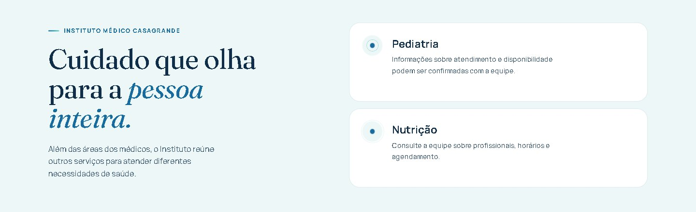

# Instituto Médico Casagrande

**Bem-estar e longevidade com cuidado médico em diferentes fases da vida.**
Artur Nogueira · SP

[Agendar pelo WhatsApp](https://wa.me/5519993735336) · [Como chegar](https://www.google.com/maps/dir//R.+24+de+Outubro,+910+-+Sala+3+-+Centro,+Artur+Nogueira+-+SP,+13160-092/) · [Instagram](https://www.instagram.com/institutomedicocasagrande)

 

## Sobre o site

Site institucional do Instituto Médico Casagrande, feito para apresentar os médicos, as áreas de cuidado e facilitar o agendamento. A navegação conta a história do Instituto com animações suaves e funciona igualmente bem no computador e no celular.

**Médicos**

- **Dr. Raul Marcel Casagrande**: ortopedia, performance e longevidade masculina
- **Dra. Rafaella Vilela Basso Casagrande**: clínica geral, nutrologia e geriatria

## Telas

### Os médicos

### Áreas de cuidado

### Outros serviços do Instituto

### No celular

<table>
  <tr>
    <td align="center" width="50%"> Site</td>
    <td align="center" width="50%"> Página de links (bio do Instagram)</td>
  </tr>
</table>

## Estrutura

| Pasta / arquivo | Conteúdo |
|---|---|
| `index.html` | Site principal |
| `links/` | Página de links para a bio do Instagram |
| `assets/` | Fotos dos médicos, logos e vídeo do consultório |
| `docs/` | Imagens usadas neste README |

Site estático em HTML, CSS e JavaScript, sem etapa de build: basta abrir o `index.html` ou publicar a pasta em qualquer hospedagem.

 

Desenvolvido por <a href="https://fernandoparmezani.com.br">Fernando Parmezani</a>

